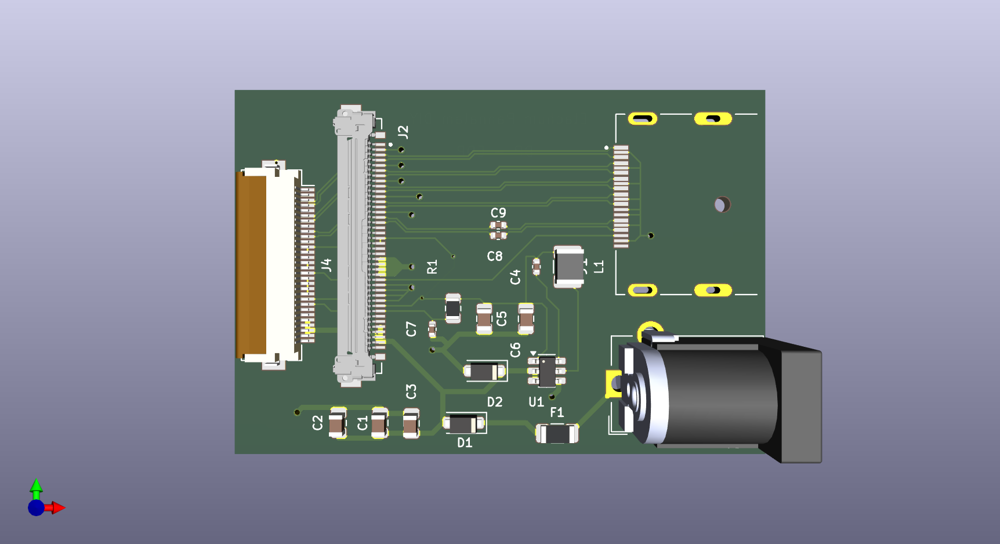
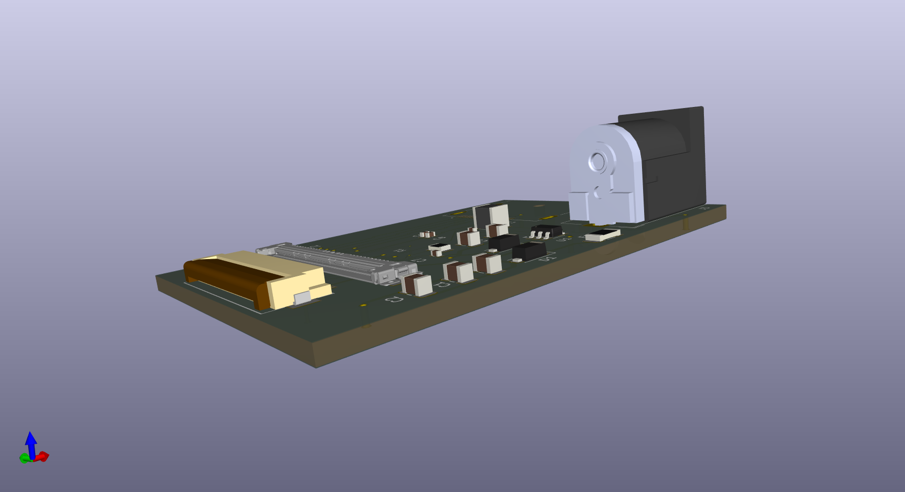

# KiCad DP to eDP Adaptor Board (4-Layer PCB)

A complete, production-ready 4-layer PCB design in KiCad for adapting standard DisplayPort (DP) signals to Embedded DisplayPort (eDP) display panels.

## Hardware & Design Highlights
* **PCB Stackup:** 4-layer board (`F_Cu`, `In1_Cu`, `In2_Cu`, `B_Cu`) designed for high-speed differential signal integrity.
* **Key Connectors:** 
  * `2041441-1` (DisplayPort Connector)
  * `DPF20102721TR` (eDP Connector)
* **Manufacturing Ready:** Includes full Gerber files, drill files (`PTH`/`NPTH`), Bill of Materials (`eDP_adaptor_board.csv`), and Pick-and-Place (`top`/`bottom`) files.

## Folder Contents
* `eDP_adaptor_board/` – Core KiCad schematic and PCB layout files.
* `2041441-1/` & `DPF20102721TR/` – Custom and vendor-sourced component footprints/3D models.
* `*.gbr` & `*.drl` – 4-layer Gerber and drill files ready for PCB fabrication.
* `*.csv` – BOM and component placement (CPL) files for PCBA assembly.

## Board Preview

*3D render of the 4-layer DP to eDP adaptor board in KiCad.*

## Video Demo & Board Testing

## Acknowledgments
* **[edp-display-board by marcbperez](https://github.com)** – Referenced during initial research for general DP-to-eDP pinout concepts. All schematics, footprints, and the 4-layer PCB layout in this repository were created independently.

## License
This hardware design (schematic, 4-layer PCB layout, and manufacturing files) is licensed under the **Creative Commons Attribution-NonCommercial 4.0 International (CC BY-NC 4.0)** license. See the [LICENSE](LICENSE) file for details.

* **Allowed:** Downloading, modifying, and manufacturing these boards for your own personal projects, hobbyist builds, or educational use (with attribution).
* **Not Allowed:** Manufacturing, distributing, or selling this board (or derivative designs) for commercial purposes without explicit permission from the author.

*(Note: Vendor component footprints such as `2041441-1` and `DPF20102721TR` remain subject to their respective component library provider terms).*
